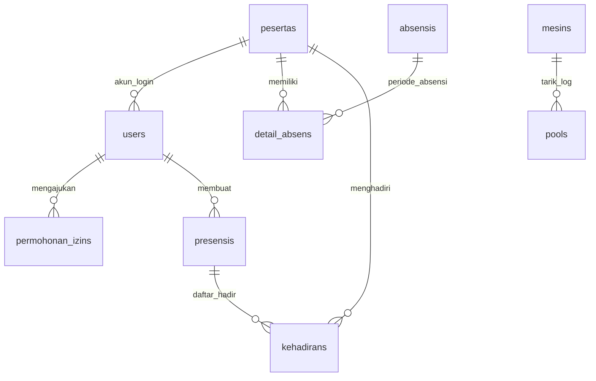

# ARAP — Aplikasi Rapat dan Administrasi Presensi

[](https://laravel.com)
[](https://www.php.net)
[](https://www.mysql.com)
[](#lisensi)

ARAP (**Aplikasi Rapat dan Administrasi Presensi**) adalah platform manajemen kehadiran pegawai/relawan dan administrasi rapat terintegrasi. Aplikasi ini dikembangkan untuk mendigitalisasi pencatatan absensi biometrik secara otomatis, mengelola pengajuan izin/sakit mandiri, menyelenggarakan administrasi rapat berbasis tanda tangan digital (*signature canvas*), serta menghasilkan rekapitulasi laporan formal berstandar dokumen resmi instansi.

---

## Daftar Isi
- [Latar Belakang & Masalah](#latar-belakang--masalah)
- [Sasaran Pengguna & Hak Akses](#sasaran-pengguna--hak-akses)
- [Fitur Utama](#fitur-utama)
- [Teknologi & Lingkungan Pengembangan](#teknologi--lingkungan-pengembangan)
- [Persyaratan Sistem](#persyaratan-sistem)
- [Panduan Instalasi](#panduan-instalasi)
- [Konfigurasi Database](#konfigurasi-database)
- [Menjalankan Aplikasi](#menjalankan-aplikasi)
- [Panduan Penggunaan Singkat](#panduan-penggunaan-singkat)
- [Struktur Direktori](#struktur-direktori)
- [Daftar Library & Dependensi](#daftar-library--dependensi)
- [Troubleshooting & Pemecahan Masalah](#troubleshooting--pemecahan-masalah)
- [Keamanan & Privasi Data](#keamanan--privasi-data)
- [Permintaan Database & Konfigurasi](#permintaan-database--konfigurasi)
- [Kontribusi & Lisensi](#kontribusi--lisensi)

---

## Latar Belakang & Masalah

Proses pencatatan presensi pegawai dan administrasi rapat di berbagai institusi sering kali menghadapi kendala efisiensi:
1. **Pencatatan Presensi Terfragmentasi:** Data log mesin absensi biometrik berada terisolasi pada perangkat fisik lokal dan memerlukan ekstraksi manual.
2. **Keterbatasan Akses Relawan:** Pegawai/relawan lapangan tidak memiliki kanal mandiri untuk melihat rekapitulasi kehadiran personal mereka secara transparan.
3. **Pengajuan Izin yang Masih Konvensional:** Pengajuan permohonan izin dan sakit yang menggunakan formulir fisik sering kali tercecer dan lambat diverifikasi.
4. **Dokumentasi Rapat Terpisah:** Pencatatan daftar hadir rapat kertas rawan hilang, tidak terdokumentasi rapi bersama notulensi, dan sulit direkapitulasi secara *real-time*.

ARAP hadir sebagai solusi komprehensif berbasis web untuk menyatukan sinkronisasi mesin biometrik, portal mandiri pegawai, pengajuan izin berlampiran dokumen medis, dan manajemen rapat digital dalam satu sistem terpusat.

---

## Sasaran Pengguna & Hak Akses

Sistem menggunakan kontrol otorisasi bertingkat (*Role-Based Gates*) yang fleksibel:

| Peran (Role) | Akses Gate | Deskripsi & Batas Wewenang |
|---|---|---|
| **Super Admin** | `ultraman` | Hak akses penuh: kelola akun pengguna, konfigurasi mesin presensi (IP/Port), kelola data master pegawai, dan monitoring sistem. |
| **Tata Usaha (TU)** | `umum` | Mengelola absensi relawan seluruh divisi, verifikasi persetujuan/penolakan izin/sakit, setting jam kerja operasional & hari libur, serta penarikan log mesin. |
| **Akademik** | `akademik` | Pengaturan batas jam akademik, setting kalender akademik, dan penarikan presensi persamaan persepsi. |
| **Staff Rapat** | `staff-access` | Akses bersama (Super Admin, TU, Akademik) untuk mengelola agenda rapat, daftar hadir rapat, dan penyusunan notulensi. |
| **Relawan / Pegawai** | `user` | Portal mandiri: melihat riwayat presensi harian personal, mengunduh laporan PDF resmi, mengajukan permohonan izin/sakit, mengunggah surat dokter, dan mengelola profil akun. |

---

## Fitur Utama

### 1. Sinkronisasi Mesin Absensi Biometrik (ZKTeco)
- **Komunikasi Soket UDP Port 4370:** Terhubung langsung ke perangkat *fingerprint* / RFID menggunakan protokol ZKTeco (`rats/zkteco`).
- **Otomatisasi via Artisan & Scheduler:** Perintah `php artisan arap:sync-machine` yang dapat dijadwalkan secara periodik maupun dieksekusi manual melalui tombol *Check Koneksi* & *Sinkronkan Data*.
- **Anti-Duplikasi & Proteksi Eksekusi:** Dilengkapi mekanisme *atomic file lock* (`storage/framework/locks/`) untuk mencegah proses ganda serta pemfilteran *cutoff timestamp* agar data presensi historis tidak tertimpa.
- **Socket Timeout Recovery:** Batas *timeout* koneksi 3 detik untuk mencegah proses macet saat jaringan mesin terputus.

### 2. Portal Presensi Mandiri Relawan
- **Dashboard Personal:** Menampilkan jadwal shift kerja aktif (jam datang & pulang) dan kartu rekapitulasi presensi per periode.
- **Isolasi Data Ketat:** Pegawai hanya dapat mengakses catatan presensi miliknya sendiri berdasarkan pemetaan NIK / UID.
- **Ekspor Laporan PDF Berstandar:** Fitur cetak rekapitulasi kehadiran dalam format PDF menggunakan format resmi **Kop Surat SPPG Kalisapu**.

### 3. Pengajuan Izin & Sakit Mandiri
- **Formulir Mandiri Relawan:** Pengajuan permohonan kategori *Izin* maupun *Sakit* dengan pilihan rentang tanggal dinamis dan kalkulasi durasi hari otomatis.
- **Unggah Dokumen Medis:** Mendukung unggah berkas surat keterangan dokter (format PDF, JPG, JPEG, PNG dengan proteksi ukuran maksimal 2MB).
- **Alur Persetujuan Admin:** Panel verifikasi bagi Admin TU untuk menyetujui (*Approve*) atau menolak (*Reject*) dengan alasan penolakan wajib.
- **Isolasi Berkas Medis (Anti-IDOR):** Berkas kesehatan hanya dapat diunduh oleh pemilik sah dan Admin yang terotorisasi.

### 4. Administrasi Rapat, Kehadiran, & Notulensi
- **Agenda Rapat Digital:** Pembuatan jadwal rapat, pemilihan peserta undangan, penentuan ruang dan agenda pembahasan.
- **Rekapitulasi Daftar Hadir Rapat:** Dashboard rekap kehadiran rapat yang menampilkan rasio peserta hadir vs terdaftar, serta tautan cepat ke lembar pengisian presensi dan cetak PDF.
- **Tanda Tangan Digital (*Digital Signature Canvas*):** Pengisian kehadiran rapat langsung melalui antarmuka web dengan goresan tanda tangan digital berbasis canvas HTML5.
- **Penyusunan Notulensi:** Pembuatan catatan rapat terstruktur yang terikat langsung dengan agenda dan daftar hadir peserta.

### 5. Pengaturan Kerja & Avatar Deterministik
- **Pengaturan Jam Kerja & Hari Libur:** Konfigurasi batas toleransi jam masuk dan pulang per kelompok divisi penugasan (Persiapan, Pengolahan, Pemorsian, Distribusi, Ompreng, Keamanan, Kebersihan).
- **Avatar Deterministik Bebas 404:** Generator avatar SVG otomatis berbasis inisial nama dan palet warna stabil per akun relawan, menjaga konsistensi tampilan tanpa *shifting* saat halaman dimuat ulang, serta mempertahankan foto kustom Admin.

---

## Teknologi & Lingkungan Pengembangan

- **Backend Framework:** [Laravel 8.x](https://laravel.com) (PHP MVC Framework)
- **Bahasa Pemrograman:** PHP 7.4.33+ (teruji dan kompatibel hingga PHP 8.3+)
- **Database Engine:** MySQL 5.7+ / MariaDB 10.3+
- **Frontend Template:** CoreUI Free Bootstrap Admin Template
- **Styling & UI:** Bootstrap 4, CoreUI Icons, FontAwesome
- **Komponen PDF:** DomPDF (`barryvdh/laravel-dompdf`)
- **Manipulasi Spreadsheet:** PhpSpreadsheet (`maatwebsite/excel`)
- **Protokol Biometrik:** `rats/zkteco` via PHP Sockets API
- **Lingkungan Pengembangan:** Laragon / XAMPP / Native Windows / Linux LAMP

---

## Persyaratan Sistem

### Perangkat Lunak Minimum
- **Sistem Operasi:** Windows 10/11, Ubuntu 20.04+, macOS, atau Linux Server
- **PHP Engine:**
  - *Versi Minimum:* **PHP 7.4.33** (terverifikasi 100% bebas ParseError)
  - *Versi Rekomendasi:* **PHP 8.1 / 8.2 / 8.3**
- **Web Server:** Apache 2.4+ / Nginx 1.18+
- **Database Server:** MySQL 5.7+ atau MariaDB 10.3+ (port default 3306 atau 3307)
- **Dependency Manager:** Composer 2.x

### Ekstensi PHP yang Wajib Aktif
Pastikan ekstensi berikut telah diaktifkan pada file `php.ini`:
```ini
extension=pdo_mysql
extension=mbstring
extension=openssl
extension=fileinfo
extension=curl
extension=xml
extension=ctype
extension=tokenizer
extension=json
extension=sockets     ; Wajib untuk integrasi mesin ZKTeco
extension=gd          ; Wajib untuk pemrosesan gambar dan avatar PNG
```

---

## Panduan Instalasi

Ikuti langkah-langkah berikut untuk memasang proyek ARAP di lingkungan lokal:

### 1. Clone Repositori
```bash
git clone https://github.com/SanjayaPutra23/arap-attendance-management.git
cd arap-attendance-management
```

### 2. Pasang Dependensi Composer
```bash
composer install
```

### 3. Konfigurasi Environment File
Salin file `.env.example` menjadi `.env`:
```bash
# Windows PowerShell
copy .env.example .env

# Linux / macOS
cp .env.example .env
```

Buka file `.env` dan sesuaikan konfigurasi database lokal Anda:
```env
APP_NAME=ARAP
APP_ENV=local
APP_KEY=
APP_DEBUG=true
APP_URL=http://localhost:8000

DB_CONNECTION=mysql
DB_HOST=127.0.0.1
DB_PORT=3306        # Sesuaikan dengan port MySQL Anda (3306 atau 3307)
DB_DATABASE=arap
DB_USERNAME=root
DB_PASSWORD=
```

### 4. Generate Application Key & Storage Link
```bash
php artisan key:generate
php artisan storage:link
```

### 5. Persiapan Database
Buat database baru bernama `arap` pada server MySQL/MariaDB lokal Anda, lalu jalankan migrasi tabel:
```bash
php artisan migrate
```
> [!NOTE]
> Database ARAP memiliki 23 file migrasi berelasi yang telah terekonsiliasi rapi. Untuk mendapatkan struktur tabel awal dan akun demo pengujian, silakan baca bagian [Konfigurasi Database](#konfigurasi-database).

---

## Konfigurasi Database

Proyek ARAP dirancang dengan struktur skema database terstandar:



### Tabel Operasional Utama
- `users`: Data kredensial pengguna (Admin, TU, Relawan) beserta relasi role.
- `pesertas`: Master biodata pegawai/relawan (UID, NIK, Divisi penugasan).
- `permohonan_izins`: Pengajuan izin/sakit, path surat dokter, status, dan catatan admin.
- `pools`: Log mentah presensi tap kartu/fingerprint dari mesin absensi.
- `absensis` & `detail_absens`: Rekapitulasi presensi harian per periode divisi.
- `presensis` & `kehadirans`: Agenda rapat dan catatan kehadiran tanda tangan digital.
- `mesins`: Konfigurasi IP address dan port mesin presensi biometrik.
- `settings` & `liburs`: Konfigurasi jam operasional dan kalender libur.

> [!IMPORTANT]
> **Perlindungan Data:** Repositori publik ini **TIDAK MENYERTAKAN** dump database produksi atau data pribadi relawan demi menjaga kerahasiaan institusi. Pengembang yang membutuhkan database dummy untuk keperluan riset dapat menghubungi kontak pengembang.

---

## Menjalankan Aplikasi

### 1. Menjalankan Server Web Lokal
Jalankan server pengembangan Laravel:
```bash
php artisan serve
```
Aplikasi dapat diakses melalui browser pada alamat:
`http://127.0.0.1:8000`

### 2. Menjalankan Sinkronisasi Mesin Biometrik
Untuk menguji komunikasi dengan mesin presensi biometrik secara manual via command line:
```bash
# Uji coba mode dry-run (hanya memeriksa tanpa menyimpan ke database)
php artisan arap:sync-machine --dry-run

# Eksekusi sinkronisasi penuh
php artisan arap:sync-machine
```

### 3. Mengaktifkan Scheduler Otomatis (Opsional)
Jika ingin mengaktifkan penarikan data mesin otomatis setiap sore hari, atur pada file `.env`:
```env
ARAP_AUTO_SYNC_ENABLED=true
ARAP_AUTO_SYNC_TIME=17:00
```
Lalu jalankan worker scheduler Laravel:
```bash
php artisan schedule:work
```

---

## Panduan Penggunaan Singkat

### A. Alur Kerja Administrator
1. **Login Admin:** Masuk melalui `/login` menggunakan akun berwenang.
2. **Dashboard Overview:** Memantau metrik kehadiran harian, statistik relawan hadir, dan status sinkronisasi mesin.
3. **Persetujuan Izin/Sakit:** Buka menu *Absensi Relawan* $\rightarrow$ *Persetujuan Izin/Sakit*. Tinjau alasan, periksa surat dokter, lalu tentukan *Setujui* atau *Tolak*.
4. **Kelola Agenda Rapat:** Buka menu *Rapat & Notulensi* $\rightarrow$ *Agenda Rapat* untuk membuat sesi rapat baru dan *Daftar Hadir Rapat* untuk memantau kehadiran serta mencetak lembar presensi.

### B. Alur Kerja Relawan
1. **Login Relawan:** Masuk menggunakan NIK / UID yang telah didaftarkan.
2. **Presensi Saya:** Melihat ringkasan hari kerja, shift penugasan, status kehadiran harian, dan tombol unduh laporan PDF resmi.
3. **Pengajuan Izin/Sakit:** Masuk ke menu *Pengajuan Izin/Sakit* $\rightarrow$ *Buat Pengajuan Baru*. Isi rentang tanggal, keterangan, unggah bukti dokter (jika sakit), dan kirim.
4. **Profil Akun:** Mengubah informasi kontak atau mengunggah foto profil kustom melalui menu *Profile*.

---

## Struktur Direktori

Berikut adalah gambaran struktur folder penting pada proyek ARAP:

```
ARAP/
├── app/
│   ├── Actions/               # Helper logika dan formatting divisi
│   ├── Console/Commands/      # Artisan commands (SyncMachineCommand)
│   ├── Http/
│   │   ├── Controllers/       # Controller Admin, Relawan, Presensi, Mesin, Profil
│   │   │   ├── Admin/         # Controller izin & manajemen pengguna Admin
│   │   │   └── User/          # Controller pengajuan izin mandiri Relawan
│   │   └── Middleware/        # Middleware autentikasi, multi-role & permissions
│   ├── Models/                # Eloquent Models (User, PermohonanIzin, Peserta, Presensi, Pool)
│   ├── Providers/             # Service Providers & Gate authorization rules
│   └── Services/              # Domain services (MachineSyncService)
├── config/                    # File konfigurasi aplikasi Laravel
├── database/
│   ├── migrations/            # 23 file migrasi database terstruktur
│   └── seeders/               # Database seeders
├── public/
│   ├── assets/                # Aset statis CoreUI, script JS, font, avatar fallback
│   └── srcblog/               # Aset grafis kop surat & logo resmi instansi
├── resources/
│   └── views/                 # Blade views antarmuka Admin & Relawan
│       ├── layouts/           # Master layout CoreUI (app.blade.php)
│       ├── page/              # View modul spesifik (izin, profil, rapat, presensi)
│       └── shared/            # Komponen navigasi (nav-builder) dan header
├── routes/
│   └── web.php                # Definisi route sistem, gate middleware, & endpoint
└── storage/                   # Berkas log, template cache, lock file, & upload publik
```

---

## Daftar Library & Dependensi

Proyek ini memanfaatkan paket-paket unggulan dari ekosistem PHP dan Laravel:

| Paket / Library | Versi | Kegunaan dalam Proyek |
|---|---|---|
| `laravel/framework` | `^8.12` | Fondasi utama arsitektur MVC, routing, Eloquent ORM, dan blade engine. |
| `laravel/fortify` | `^1.7` | Backend autentikasi berbasis sesi yang aman dan fleksibel. |
| `rats/zkteco` | `^002.0` | Driver komunikasi soket UDP untuk membaca log absensi dari mesin ZKTeco. |
| `barryvdh/laravel-dompdf` | `^1.0` | Engine rendering dokumen HTML/Blade ke file PDF beresolusi tinggi. |
| `maatwebsite/excel` | `^3.1` | Fitur ekspor dan impor lembar kerja data presensi ke format Excel/CSV. |
| `guzzlehttp/guzzle` | `^7.0.1` | Klien HTTP untuk integrasi notifikasi pesan instan / WhatsApp Gateway. |
| `fideloper/proxy` | `^4.4` | Penanganan header proxy untuk reverse proxy server (Nginx/Cloudflare). |

---

## Troubleshooting & Pemecahan Masalah

### 1. `ParseError: syntax error, unexpected '=>'`
* **Penyebab:** Web server lokal berjalan pada PHP 7.4 sementara kode menggunakan ekspresi `match` (PHP 8.0+).
* **Solusi:** Seluruh kode model telah direfaktor menggunakan `switch-case` yang kompatibel penuh dengan PHP 7.4+. Jalankan `php artisan view:clear` untuk membersihkan cache tampilan lama.

### 2. Error Koneksi Mesin Absensi: `Call to undefined function socket_create()`
* **Penyebab:** Ekstensi PHP Sockets belum diaktifkan pada file `php.ini`.
* **Solusi:** Buka file `php.ini`, hapus tanda titik koma (`;`) di depan baris `extension=sockets`, simpan file, lalu *restart* web server Laragon/Apache.

### 3. Halaman Gambar Avatar Pecah / Error 404
* **Penyebab:** Berkas `default.png` belum tersedia di direktori publik atau symlink storage belum terpasang.
* **Solusi:** Jalankan perintah `php artisan storage:link`. Sistem kini telah dilengkapi dengan generator avatar SVG deterministik berbasis identitas akun sebagai fallback otomatis.

### 4. Permasalahan Hak Akses Berkas (`Permission Denied` di Linux)
* **Solusi:** Berikan izin tulis (*write permission*) pada direktori storage dan bootstrap:
```bash
chmod -R 775 storage bootstrap/cache
chown -R www-data:www-data storage bootstrap/cache
```

---

## Keamanan & Privasi Data

Repositori publik ini mematuhi standar privasi data dan keamanan kode:
- [x] File `.env` yang memuat kredensial database asli dan rahasia aplikasi **tidak diunggah** ke Git.
- [x] Seluruh database operasional institusi dan arsip dump SQL telah dimasukkan ke dalam `.gitignore`.
- [x] Dokumen rekam medis surat keterangan dokter yang diunggah relawan disimpan pada direktori terproteksi dan dikecualikan dari *version control*.
- [x] Alur download dokumen medis dilindungi validasi kepemilikan data untuk mencegah kerentanan IDOR (*Insecure Direct Object References*).

---

## Permintaan Database & Konfigurasi

Bagi pengembang, akademisi, atau institusi yang memerlukan data contoh (*dummy database*) atau konfigurasi khusus untuk keperluan studi, riset, atau pengembangan lokal lebih lanjut, silakan mengajukan permohonan melalui email:

✉️ **Kontak Pengembang:** [masjaynew9@gmail.com](mailto:masjaynew9@gmail.com)

> *Catatan: Setiap permohonan akan ditinjau terlebih dahulu. File yang memuat kredensial produksi atau informasi identitas pribadi (PII) asli tidak akan dibagikan.*

---

## Kontribusi & Lisensi

### Kontribusi
Kontribusi pengembangan, laporan bug (*issue reporting*), dan saran perbaikan fitur sangat disambut. Silakan buat *Pull Request* atau ajukan *Issue* baru pada repositori ini dengan menyertakan deskripsi masalah yang jelas dan langkah reproduksinya.

### Lisensi
Hak Cipta © 2026 **ARAP Attendance Management**. Seluruh hak dilindungi undang-undang.  
Proyek ini dipublikasikan untuk keperluan portofolio pengembangan perangkat lunak dan edukasi. Lisensi komersial dan penggunaan skala institusi tunduk pada persetujuan pemilik hak cipta.

---
**Dikembangkan dengan integritas dan dedikasi oleh [SanjayaPutra23](https://github.com/SanjayaPutra23).**
