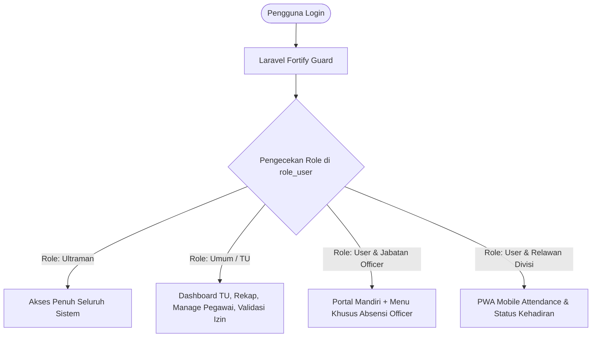
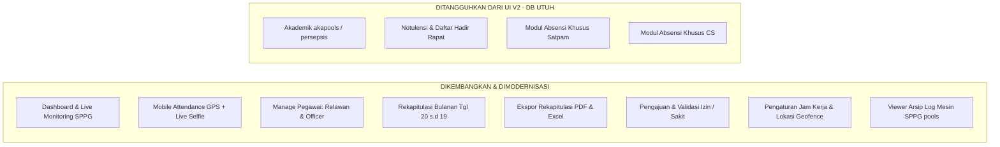
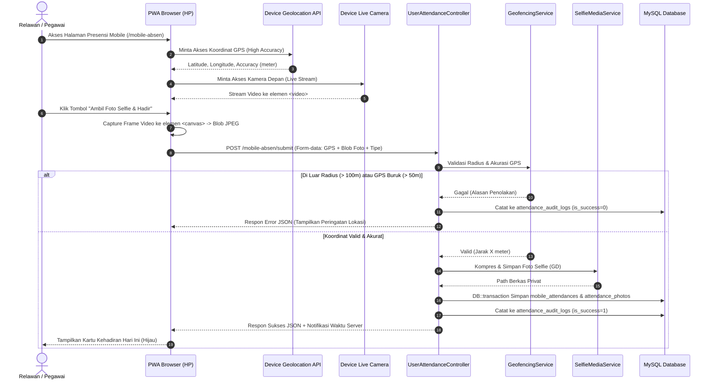
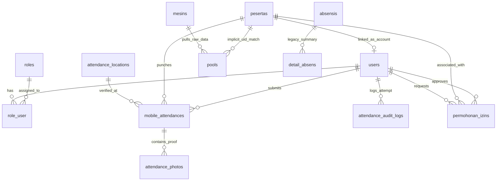
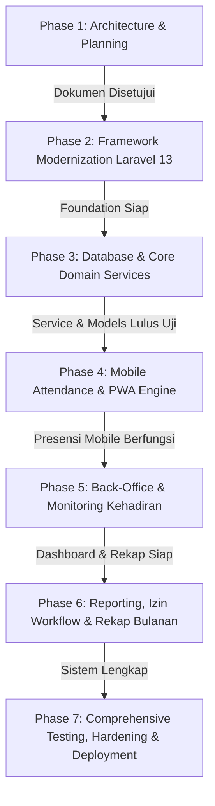
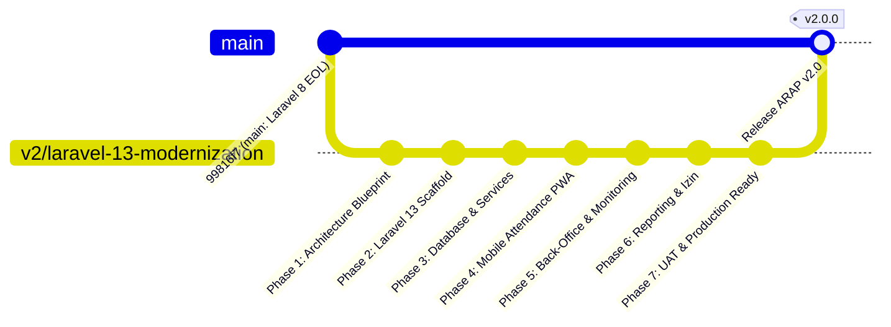

# DOKUMEN ARSITEKTUR TEKNIS & CETAK BIRU MODERNISASI (PHASE 1)
**Project ARAP v2 — Aplikasi Presensi Relawan & Pegawai SPPG Kalisapu**
*Dokumen Spesifikasi Standar Implementasi Phase 2 hingga Phase 7*

---

| Parameter | Keterangan |
|---|---|
| **Dokumen ID** | `ARAP-DOC-PHASE1-ARCH-2026` |
| **Status Dokumen** | **FINAL / APPROVED ARCHITECTURE SPECIFICATION** |
| **Target Runtime** | **PHP 8.5.12 (cli) & Laravel 13.x (v13.43.0+)** |
| **Target Database** | **MySQL 8.0.30+ (InnoDB, UTF8MB4)** |
| **Target Frontend** | **Bootstrap 5.3.x + Vite 6.x (PWA-Ready, Vanilla JS, Anti-jQuery)** |
| **Metode Modernisasi**| **Clean Rebuild Non-Destruktif** (Branch `v2/laravel-13-modernization`) |
| **Basis Data Eksisting**| `database_sql/arap.sql` (22 tabel warisan 100% utuh & aman) |

---

## DAFTAR ISI
1. [BAB 1: STRATEGI MODERNISASI & HASIL UJI KOMPATIBILITAS STACK](#bab-1-strategi-modernisasi--hasil-uji-kompatibilitas-stack)
   - 1.1. Keputusan Arsitektur: Clean Rebuild vs Upgrade Bertahap
   - 1.2. Hasil Uji Nyata Composer Dependency Resolution pada PHP 8.5.12
   - 1.3. Konfigurasi Runtime PHP 8.5.12 & Ekstensi Wajib
2. [BAB 2: ARSITEKTUR BACKEND LARAVEL 13](#bab-2-arsitektur-backend-laravel-13)
   - 2.1. Struktur Aplikasi Modern Laravel 13
   - 2.2. Autentikasi Fortify & Role-Based Access Control (RBAC)
   - 2.3. Pemetaan Modul: Modul Aktif v2 vs Modul Warisan yang Ditangguhkan
   - 2.4. Desain Service Layer Bersih (Domain Logic)
3. [BAB 3: ARSITEKTUR MOBILE ATTENDANCE (PWA)](#bab-3-arsitektur-mobile-attendance-pwa)
   - 3.1. Alur Presensi End-to-End Relawan
   - 3.2. Spesifikasi Live Camera Anti-Galeri & Anti-Fraud
   - 3.3. Spesifikasi Geofencing & Penanganan Akurasi GPS
   - 3.4. Standar PWA & Ketentuan Protokol HTTPS
   - 3.5. Penanganan Edge Cases & Kegagalan Lapangan
4. [BAB 4: RANCANGAN DATABASE NON-DESTRUKTIF](#bab-4-rancangan-database-non-destruktif)
   - 4.1. Prinsip Zero Data Loss & Preservasi 22 Tabel Lama
   - 4.2. DDL Skema Tabel Baru v2
   - 4.3. Diagram Relasi Entitas (ERD) Terpadu
   - 4.4. Strategi Akses Data Historis Mesin Fingerprint (`pools`)
5. [BAB 5: RANCANGAN UI/UX BOOTSTRAP 5 + VITE](#bab-5-rancangan-uiux-bootstrap-5--vite)
   - 5.1. Transisi dari CoreUI v3 / Bootstrap 4 ke Bootstrap 5 Modern
   - 5.2. Desain Layout Mobile-First & Desktop Dashboard
   - 5.3. Komponen Antarmuka Kunci (Peta Leaflet, Kamera, Modal)
6. [BAB 6: ROADMAP EKSEKUSI DETAIL & STRATEGI GIT](#bab-6-roadmap-eksekusi-detail--strategi-git)
   - 6.1. Breakdown Phase 2 s.d. Phase 7
   - 6.2. Standar Pengujian Otomatis (Automated Testing)
   - 6.3. Strategi Percabangan Git (Branching Workflow) & Prosedur Backup

---

## BAB 1: STRATEGI MODERNISASI & HASIL UJI KOMPATIBILITAS STACK

### 1.1. Keputusan Arsitektur: Clean Rebuild vs Upgrade Bertahap
Berdasarkan temuan audit Phase 0, codebase ARAP saat ini berada pada **Laravel 8.83.29** dengan konfigurasi platform PHP 7.4.33, CoreUI v3 (Bootstrap 4.6), dan pustaka dependensi yang telah berstatus *abandoned* (`fideloper/proxy`, `fruitcake/laravel-cors`, `facade/ignition`, `swiftmailer/swiftmailer`, dan `rats/zkteco`).

| Parameter Pembanding | Upgrade Bertahap (*In-Place Upgrade*) | Clean Rebuild Non-Destruktif (Pilihan Terpilih) |
|---|---|---|
| **Jalur Migrasi** | Melompat 5 versi mayor berturut-turut: Laravel 8 &rarr; 9 &rarr; 10 &rarr; 11 &rarr; 12 &rarr; 13. | Membangun pondasi baru langsung pada **Laravel 13.x** di branch terisolasi. |
| **Resiko Dependensi** | Sangat Tinggi (*Dependency Hell* antarmuka Flysystem v1/v3, Symfony 5/7/8, SwiftMailer ke Symfony Mailer). | **Nol Resiko** pada aplikasi eksisting; dependensi di-resolve dari repositori modern. |
| **Struktur Framework** | Masih terikat arsitektur lama (`Kernel.php`, `RouteServiceProvider`, config warisan yang membengkak). | Mengadopsi arsitektur ramping Laravel 13 (`bootstrap/app.php`, minimal configuration overhead). |
| **Keamanan Operasional** | Branch `main` berpotensi *broken* di tengah proses upgrade bertingkat. | **Branch `main` (Laravel 8) tetap 100% utuh dan siap berjalan sebagai cadangan/fallback.** |
| **Waktu Pengerjaan** | Estimasi 3x lebih lama akibat debugging kompatibilitas tiap *minor jump*. | Terukur, cepat, dan fokus langsung pada fitur bisnis SPPG Kalisapu. |

**Keputusan Final:** Melakukan **Clean Rebuild Non-Destruktif** di branch `v2/laravel-13-modernization` dengan basis data yang terhubung langsung ke skema MySQL aktif (`database_sql/arap.sql`).

---

### 1.2. Hasil Uji Nyata Composer Dependency Resolution pada PHP 8.5.12
Uji resolusi dependensi dilakukan secara terisolasi di direktori scratch menggunakan runtime binary `PHP 8.5.12 (cli)` dan `Composer 2.9.2`. Hasil uji dry-run membuktikan bahwa seluruh pustaka utama berhasil di-resolve tanpa konflik:

```json
{
    "require": {
        "php": "^8.5",
        "laravel/framework": "^13.0",
        "laravel/fortify": "^1.25",
        "barryvdh/laravel-dompdf": "^3.0",
        "maatwebsite/excel": "^3.1"
    }
}
```

#### Hasil Resolusi Paket Aktual:
1. **`laravel/framework`:** Berhasil mengunci versi **`v13.43.0`** (dengan sub-dependensi `fruitcake/php-cors v1.4.0`, `nesbot/carbon 3.15.1`, `league/flysystem 3.36.0`, `symfony/* v8.1.x`, `guzzlehttp/guzzle 8.6.0`).
2. **`laravel/fortify`:** Berhasil mengunci versi **`v1.43.0`** (dengan dukungan Two-Factor Authentication, WebAuthn/Passkeys, dan hashing Argon2/Bcrypt).
3. **`barryvdh/laravel-dompdf`:** Berhasil mengunci versi **`v3.1.2`** (menggunakan engine `dompdf/dompdf v3.1.6` yang mendukung PHP 8.2 s.d. 8.5 dan kompatibel dengan rendering HTML/CSS laporan absensi).
4. **`maatwebsite/excel`:** Berhasil mengunci versi **`3.1.68`** (didukung oleh `phpoffice/phpspreadsheet 1.30.0` dan `maennchen/zipstream-php 3.2.2`).

> [!NOTE]
> **Catatan Kompatibilitas Excel:** `maatwebsite/excel:3.1.68` berhasil terkunci dan kompatibel dengan PHP 8.5. Namun, jika pada pengujian ekspor data besar ditemukan *deprecation warning* dari PhpSpreadsheet di PHP 8.5, disiapkan fallback ringan berbasis streaming: `openspout/openspout` atau `rap2hpoutre/fast-excel` yang bebas dari isu memory leak.

---

### 1.3. Konfigurasi Runtime PHP 8.5.12 & Ekstensi Wajib
Berdasarkan audit konfigurasi `C:\laragon\bin\php\php-8.5.12-nts-Win32-vs17-x64\php.ini`, berikut status ekstensi yang wajib disesuaikan:

| Ekstensi PHP | Status di `php.ini` Saat Ini | Status Target v2 | Peran dalam ARAP v2 |
|---|---|---|---|
| `pdo_mysql` | **Aktif** | **Aktif** | Koneksi database MySQL 8.x |
| `openssl` | **Aktif** | **Aktif** | Enkripsi HTTPS, Token API, dan Fortify |
| `mbstring` | **Aktif** | **Aktif** | Manipulasi string multibyte dan validasi teks |
| `fileinfo` | **Aktif** | **Aktif** | Validasi MIME type foto selfie dan bukti surat dokter |
| `gd` | **Aktif** | **Aktif** | Kompresi, resize, dan pengolahan foto selfie webcam |
| `exif` | **Aktif** | **Aktif** | Normalisasi orientasi foto kamera HP |
| `intl` | **Aktif** | **Aktif** | Format tanggal, waktu, dan angka Bahasa Indonesia |
| `bcmath` | **Aktif (Built-in)**| **Aktif** | Perhitungan matematika presisi tinggi |
| `zip` | **Nonaktif (Terkomentar)**| **WAJIB DIAKTIFKAN** | Dibutuhkan oleh Composer dan ekspor Excel |
| `sockets` | **Nonaktif (Terkomentar)**| **WAJIB DIAKTIFKAN** | Komunikasi UDP Port 4370 ke mesin ZKTeco |
| `imagick` | **Tidak Tersedia** | **Ditinggalkan** | Digantikan sepenuhnya oleh `ext-gd` untuk resize foto |

```ini
; Konfigurasi Wajib pada php.ini PHP 8.5.12:
extension=curl
extension=fileinfo
extension=gd
extension=intl
extension=mbstring
extension=mysqli
extension=openssl
extension=pdo_mysql
extension=sockets       ; <-- Hapus tanda titik koma (;) untuk mengaktifkan
extension=zip           ; <-- Hapus tanda titik koma (;) untuk mengaktifkan
upload_max_filesize = 10M
post_max_size = 12M
memory_limit = 256M
date.timezone = "Asia/Jakarta"
```

---

## BAB 2: ARSITEKTUR BACKEND LARAVEL 13

### 2.1. Struktur Aplikasi Modern Laravel 13
Laravel 13 mengusung struktur modular tanpa berkas usang seperti `app/Http/Kernel.php`, `app/Console/Kernel.php`, maupun sejumlah *RouteServiceProvider*. Seluruh konfigurasi middleware, routing, dan penanganan exception dipusatkan di [bootstrap/app.php](file:///c:/laragon/www/Absensi/bootstrap/app.php):

```
app/
├── Actions/
│   └── Fortify/                 # Login, Reset Password, Create New User
├── Console/
│   └── Commands/
│       ├── ArchiveOldBiometricLogs.php
│       └── SyncZktecoLogsCommand.php
├── Domain/
│   ├── Attendance/              # Domain Absensi (Kalkulasi, Rekapitulasi)
│   ├── Biometric/               # Domain Fingerprint (ZKTeco Driver)
│   ├── Geofencing/              # Domain Lokasi & GPS (Haversine)
│   └── Media/                   # Domain Media (Kompresi Selfie GD)
├── Http/
│   ├── Controllers/
│   │   ├── Admin/               # Dashboard, Manage Pegawai, Lokasi, Rekap, Izin
│   │   ├── Officer/             # Menu Khusus Officer & Rekap Officer
│   │   ├── User/                # Mobile Attendance Check-in/out, Pengajuan Izin
│   │   └── Archive/             # Arsip Log Fingerprint Mesin Lama
│   ├── Middleware/
│   │   ├── EnsureWithinGeofence.php
│   │   └── RoleMiddleware.php
│   └── Requests/
│       ├── CheckInRequest.php
│       ├── CheckOutRequest.php
│       └── StorePesertaRequest.php
├── Models/                      # Eloquent Models (Lama + Baru)
└── Services/                    # Service Layer Application
    ├── AttendanceCalculationService.php
    ├── GeofencingService.php
    ├── MachineSyncService.php
    └── SelfieMediaService.php
bootstrap/
└── app.php                      # Sentral Routing, Middleware, Exceptions
config/                          # Config Minimalis
database/
├── migrations/                  # Migrasi Tabel Baru (v2)
└── seeders/                     # Seeders Lokasi SPPG & Akun Default
```

---

### 2.2. Autentikasi Fortify & Role-Based Access Control (RBAC)
Autentikasi tetap menggunakan tabel [users](file:///c:/laragon/www/Absensi/app/Models/User.php) yang berelasi *many-to-many* dengan [roles](file:///c:/laragon/www/Absensi/app/Models/Role.php) melalui tabel pivot `role_user`. Relawan yang login via HP menggunakan akun yang sudah tersinkronisasi (`email` atau `nik`).



- **Role `Ultraman`:** Super Administrator (akses konfigurasi mesin, lokasi geofence, manage user/roles, dan database logs).
- **Role `Umum`:** Petugas Tata Usaha (manajemen data relawan & officer, monitoring live kehadiran, persetujuan izin/sakit, dan ekspor laporan).
- **Role `User`:** Relawan & Officer (akses PWA Mobile Attendance, riwayat presensi mandiri, dan pengajuan izin/sakit).

---

### 2.3. Pemetaan Modul: Modul Aktif v2 vs Modul Warisan yang Ditangguhkan



> [!IMPORTANT]
> **Garansi Non-Destruktif:** Tabel database milik modul warisan (`akapools`, `persepsis`, `detail_persepsis`, `notulensis`, `kehadirans`, `presensis`, `pods`, `pesertas_old`) **TIDAK DIHAPUS dan TIDAK DIMODIFIKASI**. Modul-modul ini hanya tidak ditampilkan pada menu navigasi v2 demi menjaga fokus pada operasional SPPG Kalisapu.

---

### 2.4. Desain Service Layer Bersih (Domain Logic)

#### A. `AttendanceCalculationService`
Bertanggung jawab menghitung kehadiran berdasarkan aturan baku bisnis SPPG:
- **Periode Perhitungan:** Bulanan terhitung mulai dari tanggal 20 bulan sebelumnya ($M-1$) hingga tanggal 19 bulan berjalan ($M$).
- **Hari Libur:** Mengambil data libur nasional dari tabel `liburs` serta hari Sabtu dan Minggu (kecuali jika divisi memiliki jadwal shift khusus).
- **Sistem Poin:**
  - **1.0 (Tepat Waktu):** Waktu *check-in* $\le$ `jam_datang_{divisi}` DAN waktu *check-out* $\ge$ `jam_pulang_{divisi}`.
  - **0.8 (Hadir Biasa):** Terlambat datang, pulang lebih awal, atau hanya melakukan *check-in* (tidak *check-out*).
  - **0.0 (Alpha / Tidak Hadir):** Tidak ada catatan presensi pada hari kerja tanpa adanya permohonan izin/sakit yang disetujui.
- **Penyatuan Riwayat:** Mampu mengagregasikan rekaman baru dari `mobile_attendances` bersama dengan riwayat lama di tabel `pools` dan `detail_absens`.

#### B. `GeofencingService`
Menghitung jarak spasial antara titik koordinat presensi relawan dengan titik sentral Dapur SPPG Kalisapu menggunakan rumus **Haversine**:

$$\Delta \phi = \phi_2 - \phi_1, \quad \Delta \lambda = \lambda_2 - \lambda_1$$

$$a = \sin^2\left(\frac{\Delta \phi}{2}\right) + \cos(\phi_1)\cos(\phi_2)\sin^2\left(\frac{\Delta \lambda}{2}\right)$$

$$c = 2 \cdot \text{atan2}\left(\sqrt{a}, \sqrt{1-a}\right), \quad d = R \cdot c$$

Dimana:
- $R = 6.371.000\text{ meter}$ (radius rata-rata bumi).
- $\phi_1, \lambda_1$ = Latitude & Longitude pusat SPPG (diambil dari `attendance_locations`).
- $\phi_2, \lambda_2$ = Latitude & Longitude relawan dari sensor GPS perangkat HP.
- **Validasi Ketat:**
  1. $d \le \text{radius\_meters}$ (default 100 meter dari lokasi SPPG).
  2. $\text{accuracy\_meters} \le \text{max\_gps\_accuracy\_meters}$ (default maksimal 50 meter toleransi akurasi GPS).

#### C. `SelfieMediaService`
Mengelola pemrosesan berkas foto selfie yang ditangkap melalui webcam browser:
- Menerima payload base64 / binary blob gambar.
- Memvalidasi MIME type (`image/jpeg`, `image/webp`).
- Melakukan kompresi dan resize resolusi maksimal $1024 \times 768$ pixel pada kualitas JPEG 80% menggunakan ekstensi PHP `ext-gd`.
- Menghasilkan ukuran file efisien (antara 80 KB hingga 150 KB) untuk menghemat ruang penyimpanan.
- Menyimpan berkas di jalur privat: `storage/app/private/attendance_photos/YYYY/MM/{uuid}.jpg`.
- Gambar tidak dapat diakses secara publik (wajib melalui rute otorisasi / signed URL).

---

## BAB 3: ARSITEKTUR MOBILE ATTENDANCE (PWA)

### 3.1. Alur Presensi End-to-End Relawan



---

### 3.2. Spesifikasi Live Camera Anti-Galeri & Anti-Fraud
Untuk memastikan kehadiran fisik relawan secara nyata dan mencegah pemalsuan foto menggunakan galeri:

```javascript
// Konfigurasi Standar Capture Video Kamera Depan:
const constraints = {
    audio: false,
    video: {
        facingMode: 'user', // Memaksa kamera depan HP
        width: { ideal: 1280 },
        height: { ideal: 720 }
    }
};

// Mengaktifkan stream langsung ke elemen video
navigator.mediaDevices.getUserMedia(constraints)
    .then(stream => {
        videoElement.srcObject = stream;
        videoElement.play();
    })
    .catch(err => {
        handleCameraError(err);
    });

// Menangkap frame video saat tombol ditekan
function captureFrame() {
    const canvas = document.createElement('canvas');
    canvas.width = videoElement.videoWidth;
    canvas.height = videoElement.videoHeight;
    const ctx = canvas.getContext('2d');
    ctx.drawImage(videoElement, 0, 0, canvas.width, canvas.height);
    
    canvas.toBlob((blob) => {
        submitAttendancePayload(blob);
    }, 'image/jpeg', 0.85);
}
```

#### Aturan Ketat Anti-Galeri:
1. **Peniadaan Elemen File Input:** Tidak ada elemen `<input type="file" accept="image/*">` pada form presensi mobile.
2. **Ketiadaan Pilihan Upload Galeri:** Form submit hanya menerima payload yang dihasilkan langsung dari *canvas buffer stream video*.
3. **Pernyataan Transparansi Teknis:** Sistem mengandalkan otentikasi stream kamera langsung (*direct stream capture*). Sistem **belum menerapkan AI Face Recognition atau Biometric Liveness Detection**; verifikasi keabsahan foto dilakukan secara visual oleh Admin Tata Usaha melalui dashboard monitoring.

---

### 3.3. Spesifikasi Geofencing & Penanganan Akurasi GPS
1. **Parameter Lokasi Sentral:** Titik sentral Dapur SPPG Kalisapu didefinisikan secara dinamis pada tabel `attendance_locations`.
2. **Threshold Geofence:**
   - **Maksimal Radius:** `radius_meters` = 100 meter (dapat disesuaikan di UI Admin).
   - **Maksimal Nilai Akurasi GPS:** `max_gps_accuracy_meters` = 50 meter. Jika sensor GPS HP mengembalikan akurasi 150 meter (akibat sinyal GPS lemah / estimasi tower seluler), presensi ditolak dengan instruksi untuk berpindah ke area terbuka.

---

### 3.4. Standar PWA & Ketentuan Protokol HTTPS
1. **Web App Manifest (`public/manifest.json`):**
   - `name`: "ARAP Presensi SPPG Kalisapu"
   - `short_name`: "ARAP Mobile"
   - `display`: "standalone"
   - `start_url`: "/mobile-absen"
   - `theme_color`: "#1e3a8a"
   - `background_color`: "#f8fafc"
   - `icons`: Icon 192x192 PNG dan 512x512 PNG.
2. **Service Worker (`public/sw.js`):**
   - Men-cache aset statis inti (CSS Bootstrap 5, ikon, JS, logo) untuk performa instan (*instant load*).
   - Seluruh request presensi API (`/mobile-absen/submit`) diatur sebagai *Network Only* (tidak boleh di-cache agar data selalu sinkron dengan jam server).
3. **Ketentuan Wajib HTTPS:**
   - API `navigator.mediaDevices.getUserMedia` dan `navigator.geolocation` dikunci oleh standar browser modern (*Secure Context*).
   - Fitur hanya dapat beroperasi pada `http://localhost` (lingkungan dev) atau koneksi **`https://` dengan sertifikat SSL valid** pada server produksi.

---

### 3.5. Penanganan Edge Cases & Kegagalan Lapangan

| Kasus Khusus / Masalah | Tindakan Pencegahan & Solusi Sistem |
|---|---|
| **Izin Kamera Ditolak Pengguna** | Tampilkan modal panduan visual untuk mengaktifkan izin kamera di pengaturan browser HP; kunci tombol submit. |
| **Izin Lokasi (GPS) Ditolak** | Tombol presensi dinonaktifkan dengan peringatan bahwa lokasi wajib untuk verifikasi kehadiran. |
| **Akurasi GPS Buruk (> 50m)** | Presensi ditolak; tampilkan instruksi: "Sinyal GPS lemah (akurasi X meter). Silakan nyalakan GPS akurasi tinggi atau keluar ruangan." |
| **Koneksi Internet Putus Saat Submit** | Tampilkan pesan kegagalan kirim yang ramah; jangan reset form agar relawan dapat mencoba kirim ulang setelah sinyal stabil. |
| **Klik Ganda (*Double Submit*)** | Tombol submit langsung disabled + menampilkan animasi *spinner* saat request pertama dikirim; tabel database memiliki indeks `UNIQUE(peserta_id, attendance_date)`. |
| **Relawan Lupa Check-out** | Sistem tetap mencatat *check-in*, status dihitung sebagai "Hadir Biasa" dengan skor `0.8` (sesuai aturan bisnis eksisting). |
| **Relawan Sedang Berstatus Izin/Sakit** | Tampilan mobile mendeteksi permohonan izin yang disetujui pada tanggal tersebut dan menampilkan banner: "Hari ini Anda berstatus Izin/Sakit". |

---

## BAB 4: RANCANGAN DATABASE NON-DESTRUKTIF

### 4.1. Prinsip Zero Data Loss & Preservasi 22 Tabel Lama
Untuk menjamin kontinuitas operasional SPPG tanpa perlu mendata ulang relawan:
1. **Dilarang Menjalankan Perintah Destruktif:** `migrate:fresh`, `migrate:reset`, `DROP TABLE`, atau `TRUNCATE TABLE` dilarang keras.
2. **Data Master Eksisting:**
   - Tabel `pesertas` (47 baris relawan/pegawai aktif) tetap menjadi master profil.
   - Tabel `users` (49 akun login) tetap menjadi master otentikasi login.
   - Tabel `roles` dan `role_user` tetap menjadi referensi hak akses.
   - Tabel `settings` (30 baris) tetap menjadi master batas jam kerja per divisi.
   - Tabel `liburs` (95 baris) tetap menjadi acuan kalender libur nasional.
   - Tabel `pools` (9.838 baris) tetap utuh sebagai arsip rekaman mesin fingerprint masa lalu.

---

### 4.2. DDL Skema Tabel Baru v2

```sql
-- 1. Master Lokasi SPPG & Geofence
CREATE TABLE `attendance_locations` (
  `id` BIGINT UNSIGNED NOT NULL AUTO_INCREMENT,
  `name` VARCHAR(100) NOT NULL,
  `address` TEXT NULL DEFAULT NULL,
  `latitude` DECIMAL(10, 8) NOT NULL,
  `longitude` DECIMAL(11, 8) NOT NULL,
  `radius_meters` INT UNSIGNED NOT NULL DEFAULT 100,
  `max_gps_accuracy_meters` INT UNSIGNED NOT NULL DEFAULT 50,
  `is_active` TINYINT(1) NOT NULL DEFAULT 1,
  `created_at` TIMESTAMP NULL DEFAULT NULL,
  `updated_at` TIMESTAMP NULL DEFAULT NULL,
  PRIMARY KEY (`id`)
) ENGINE=InnoDB DEFAULT CHARSET=utf8mb4 COLLATE=utf8mb4_unicode_ci;

-- 2. Rekaman Presensi Harian Mobile Relawan
CREATE TABLE `mobile_attendances` (
  `id` BIGINT UNSIGNED NOT NULL AUTO_INCREMENT,
  `peserta_id` BIGINT UNSIGNED NOT NULL,
  `user_id` BIGINT UNSIGNED NOT NULL,
  `attendance_location_id` BIGINT UNSIGNED NULL DEFAULT NULL,
  `attendance_date` DATE NOT NULL,
  `check_in_at` TIMESTAMP NULL DEFAULT NULL,
  `check_in_latitude` DECIMAL(10, 8) NULL DEFAULT NULL,
  `check_in_longitude` DECIMAL(11, 8) NULL DEFAULT NULL,
  `check_in_distance_meters` DECIMAL(8, 2) NULL DEFAULT NULL,
  `check_in_accuracy_meters` DECIMAL(8, 2) NULL DEFAULT NULL,
  `check_out_at` TIMESTAMP NULL DEFAULT NULL,
  `check_out_latitude` DECIMAL(10, 8) NULL DEFAULT NULL,
  `check_out_longitude` DECIMAL(11, 8) NULL DEFAULT NULL,
  `check_out_distance_meters` DECIMAL(8, 2) NULL DEFAULT NULL,
  `check_out_accuracy_meters` DECIMAL(8, 2) NULL DEFAULT NULL,
  `status` ENUM('hadir', 'terlambat', 'pulang_awal', 'izin', 'sakit', 'alpha') NOT NULL DEFAULT 'hadir',
  `score` DECIMAL(3, 2) NOT NULL DEFAULT 1.00,
  `source` ENUM('mobile', 'fingerprint', 'system') NOT NULL DEFAULT 'mobile',
  `notes` TEXT NULL DEFAULT NULL,
  `created_at` TIMESTAMP NULL DEFAULT NULL,
  `updated_at` TIMESTAMP NULL DEFAULT NULL,
  PRIMARY KEY (`id`),
  UNIQUE KEY `uk_peserta_date` (`peserta_id`, `attendance_date`),
  KEY `idx_user_date` (`user_id`, `attendance_date`),
  KEY `idx_date_status` (`attendance_date`, `status`),
  CONSTRAINT `fk_ma_peserta_id` FOREIGN KEY (`peserta_id`) REFERENCES `pesertas` (`id`) ON DELETE RESTRICT,
  CONSTRAINT `fk_ma_user_id` FOREIGN KEY (`user_id`) REFERENCES `users` (`id`) ON DELETE RESTRICT,
  CONSTRAINT `fk_ma_location_id` FOREIGN KEY (`attendance_location_id`) REFERENCES `attendance_locations` (`id`) ON DELETE SET NULL
) ENGINE=InnoDB DEFAULT CHARSET=utf8mb4 COLLATE=utf8mb4_unicode_ci;

-- 3. Berkas Foto Selfie Presensi
CREATE TABLE `attendance_photos` (
  `id` BIGINT UNSIGNED NOT NULL AUTO_INCREMENT,
  `mobile_attendance_id` BIGINT UNSIGNED NOT NULL,
  `type` ENUM('check_in', 'check_out') NOT NULL,
  `disk` VARCHAR(50) NOT NULL DEFAULT 'local',
  `path` VARCHAR(255) NOT NULL,
  `mime_type` VARCHAR(50) NOT NULL DEFAULT 'image/jpeg',
  `file_size_bytes` INT UNSIGNED NOT NULL,
  `sha256_hash` VARCHAR(64) NULL DEFAULT NULL,
  `captured_at` TIMESTAMP NOT NULL,
  `created_at` TIMESTAMP NULL DEFAULT NULL,
  `updated_at` TIMESTAMP NULL DEFAULT NULL,
  PRIMARY KEY (`id`),
  KEY `idx_photo_attendance` (`mobile_attendance_id`, `type`),
  CONSTRAINT `fk_photo_attendance_id` FOREIGN KEY (`mobile_attendance_id`) REFERENCES `mobile_attendances` (`id`) ON DELETE CASCADE
) ENGINE=InnoDB DEFAULT CHARSET=utf8mb4 COLLATE=utf8mb4_unicode_ci;

-- 4. Audit Trail Percobaan Presensi
CREATE TABLE `attendance_audit_logs` (
  `id` BIGINT UNSIGNED NOT NULL AUTO_INCREMENT,
  `user_id` BIGINT UNSIGNED NOT NULL,
  `peserta_id` BIGINT UNSIGNED NULL DEFAULT NULL,
  `attempt_type` ENUM('check_in', 'check_out') NOT NULL,
  `attempted_at` TIMESTAMP NOT NULL,
  `latitude` DECIMAL(10, 8) NULL DEFAULT NULL,
  `longitude` DECIMAL(11, 8) NULL DEFAULT NULL,
  `distance_meters` DECIMAL(8, 2) NULL DEFAULT NULL,
  `accuracy_meters` DECIMAL(8, 2) NULL DEFAULT NULL,
  `is_success` TINYINT(1) NOT NULL,
  `failure_reason` VARCHAR(255) NULL DEFAULT NULL,
  `ip_address` VARCHAR(45) NULL DEFAULT NULL,
  `user_agent` TEXT NULL DEFAULT NULL,
  `created_at` TIMESTAMP NULL DEFAULT NULL,
  PRIMARY KEY (`id`),
  KEY `idx_audit_user` (`user_id`, `attempted_at`),
  KEY `idx_audit_status` (`is_success`, `attempted_at`),
  CONSTRAINT `fk_audit_user_id` FOREIGN KEY (`user_id`) REFERENCES `users` (`id`) ON DELETE CASCADE
) ENGINE=InnoDB DEFAULT CHARSET=utf8mb4 COLLATE=utf8mb4_unicode_ci;
```

---

### 4.3. Diagram Relasi Entitas (ERD) Terpadu



---

### 4.4. Strategi Akses Data Historis Mesin Fingerprint (`pools`)
Untuk menampilkan data historis masa lalu tanpa merusak tabel `pools`:
1. **Model Eloquent Read-Only:** Model `App\Models\Pool` tetap tersedia dalam mode baca (`readonly`) untuk mengakses 9.838 rekaman masa lalu mesin `FPDAPUR1`.
2. **Menu Khusus "Arsip Log Fingerprint":** Menu terpisah di antarmuka Tata Usaha untuk menelusuri data tap mentah mesin berdasarkan tanggal, PIN/UID, dan jenis tap (In/Out).
3. **Agregasi Rekapitulasi Terpadu:** Pada modul rekapitulasi, sistem secara otomatis membaca data dari `mobile_attendances` untuk bulan berjalan, dan dapat menarik data dari `detail_absens` / `pools` jika pengguna memilih periode bulan arsip sebelum modernisasi.

---

## BAB 5: RANCANGAN UI/UX BOOTSTRAP 5 + VITE

### 5.1. Transisi dari CoreUI v3 / Bootstrap 4 ke Bootstrap 5 Modern
- **Pembersihan Dependensi:** Menghapus pustaka usang `coreui.bundle.min.js`, `coreui-utils.js`, `jquery.min.js`, dan `laravel-mix`.
- **Aset Modern via Vite:** Menggunakan Vite 6 + PostCSS + Bootstrap 5.3.x dengan CSS kustom ringan bertema SPPG Kalisapu (Nuansa Biru Navy `#1e3a8a` dan Hijau Emerald `#059669`).
- **Ikon Vektor:** Menggunakan **Bootstrap Icons (SVG Sprite)** lokal, menghindari CDN eksternal agar PWA dapat berfungsi penuh secara offline.

---

### 5.2. Desain Layout Mobile-First & Desktop Dashboard

#### A. Layout Desktop (Tata Usaha & Admin)
- **Sidebar Navigasi:**
  - *Dashboard Utama*
  - *Absensi & Kehadiran:*
    - Monitoring Hadir Hari Ini (Live Realtime List)
    - Rekap Absensi Bulanan (Filter Divisi: Persiapan, Pengolahan, Pemorsian, Distribusi, Ompreng, Keamanan, Kebersihan, **Officer**)
    - Rekap Absensi Mingguan
  - *Master Pegawai:*
    - Data Relawan & Pegawai (termasuk jabatan **Officer**)
    - Manajemen Akun Login & Sinkronisasi Relawan
  - *Pengajuan Izin / Sakit:*
    - Verifikasi Izin & Sakit (dengan Preview Surat Dokter)
  - *Pengaturan Sistem:*
    - Pengaturan Jam Kerja per Divisi (termasuk jam kerja **Officer**)
    - Pengaturan Geofence & Titik SPPG Kalisapu
    - Kalender Hari Libur Nasional
    - Arsip Log Mesin Fingerprint (`pools`)

#### B. Layout Mobile (PWA Relawan & Officer)
- Tampilan kartu bersih (*Clean Card Interface*) satu kolom.
- Indikator Status Hari Ini:
  - Belum Hadir (Abu-abu / Merah)
  - Sudah Check-In (Kuning / Biru)
  - Selesai Bertugas / Check-Out (Hijau)
- Komponen Live Webcam Stream dengan bingkai oval panduan wajah.
- Indikator Jarak Realtime (contoh: `Jarak: 32m dari Dapur SPPG - Di dalam Radius`).

---

### 5.3. Komponen Antarmuka Kunci

1. **Peta Interaktif Geofence (Leaflet.js + OpenStreetMap):**
   - Menampilkan poligon lingkaran radius 100 meter di atas Dapur SPPG Kalisapu.
   - Menampilkan pin marker biru untuk lokasi SPPG dan pin marker merah untuk titik presensi relawan.
   - Beroperasi 100% menggunakan library lokal tanpa memerlukan Google Maps API Key berbayar.
2. **Modal Viewer Foto Selfie & Surat Dokter:**
   - Modal Bootstrap 5 responsif untuk menampilkan bukti foto selfie yang terenkripsi rutenya saat Admin TU mengevaluasi kehadiran.
3. **Komponen Notifikasi Feedback:**
   - Toast notification Bootstrap 5 untuk umpan balik instan (Check-in berhasil, GPS di luar radius, izin kamera ditolak).

---

## BAB 6: ROADMAP EKSEKUSI DETAIL & STRATEGI GIT

### 6.1. Breakdown Phase 2 s.d. Phase 7



#### Rincian Fase:
- **Phase 2 — Framework Modernization & Scaffold:**
  - Inisialisasi branch `v2/laravel-13-modernization`.
  - Instalasi Laravel 13.x, Fortify, Bootstrap 5, Vite, dan konfigurasi `bootstrap/app.php`.
  - Migrasi sistem RBAC Fortify agar mengenali akun pada tabel `users` dan `roles` lama.
- **Phase 3 — Database Schema & Core Domain Services:**
  - Pembuatan migrasi tabel baru (`attendance_locations`, `mobile_attendances`, `attendance_photos`, `attendance_audit_logs`).
  - Implementasi `AttendanceCalculationService`, `GeofencingService`, dan `SelfieMediaService`.
  - Penulisan automated unit tests untuk logika Haversine dan perhitungan poin bulanan.
- **Phase 4 — Mobile Attendance & PWA Engine:**
  - Pembangunan antarmuka PWA mobile presensi.
  - Integrasi Live Webcam Anti-Galeri & Geolocation API.
  - Implementasi Controller Check-in & Check-out berserta audit logging.
- **Phase 5 — Back-Office Dashboard & Monitoring:**
  - Pembangunan dashboard Tata Usaha modern (rekap kehadiran realtime hari ini).
  - Manajemen pegawai & jabatan Officer.
  - Manajemen lokasi geofence & pengaturan jam kerja divisi.
- **Phase 6 — Reporting, Leave Workflow & Integration:**
  - Pembaruan alur pengajuan dan verifikasi Izin/Sakit mandiri relawan.
  - Mesin rekapitulasi bulanan (tanggal 20 s/d 19) dengan ekspor PDF & Excel.
  - Viewer arsip data log lama tabel `pools`.
- **Phase 7 — Verification, Hardening & Handover:**
  - End-to-end user acceptance testing (UAT).
  - Security audit (CSRF, MIME validation, storage authorization).
  - Dokumentasi deployment produksi dan panduan operasional.

---

### 6.2. Standar Pengujian Otomatis (Automated Testing)
Sebelum kode diizinkan masuk ke tahap deployment, wajib memenuhi *acceptance criteria* melalui PHPUnit 11:
1. **`GeofencingServiceTest`:**
   - Uji koordinat dalam radius 50m &rarr; *Assert True*.
   - Uji koordinat di luar radius 150m &rarr; *Assert False (OUT_OF_GEOFENCE)*.
   - Uji akurasi GPS buruk (accuracy 80m) &rarr; *Assert False (ACCURACY_TOO_LOW)*.
2. **`AttendanceCalculationServiceTest`:**
   - Uji relawan masuk tepat waktu & pulang tepat waktu &rarr; *Score 1.0*.
   - Uji relawan terlambat masuk atau pulang lebih awal &rarr; *Score 0.8*.
   - Uji relawan hanya tap 1x &rarr; *Score 0.8*.
   - Uji hari kerja tanpa absensi &rarr; *Score 0.0 (Alpha)*.
   - Uji hari libur &rarr; *Dikecualikan dari perhitungan*.
3. **`SelfieMediaServiceTest`:**
   - Uji upload file palsu (bukan JPEG/PNG) &rarr; *Validation Exception*.
   - Uji kompresi gambar &rarr; *Ukuran file akhir < 200 KB*.

---

### 6.3. Strategi Percabangan Git (Branching Workflow) & Prosedur Backup



#### Aturan Ketat Git:
1. Branch `main` dikunci (*protected*) dan tidak menerima perubahan langsung sebelum Phase 7 selesai dan diuji.
2. Seluruh pekerjaan modernisasi v2 berjalan eksklusif pada branch `v2/laravel-13-modernization`.
3. Backup basis data terverifikasi disimpan secara aman di `database_sql/arap.sql` sebelum migrasi tabel baru dijalankan.

---
*Dokumen ini disusun dan diverifikasi secara resmi sebagai dasar teknis pelaksanaan Project ARAP v2 SPPG Kalisapu.*
