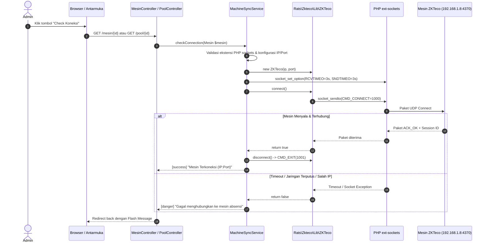
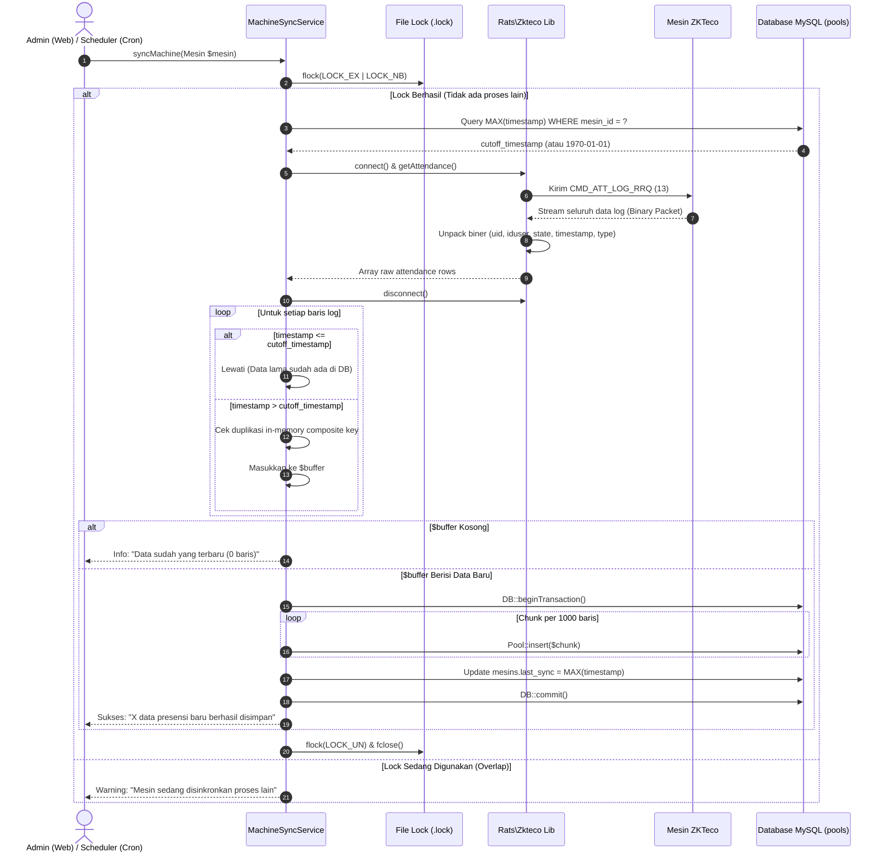

# LAPORAN AUDIT TEKNIS INTEGRASI MESIN FINGERPRINT ZKTECO PADA APLIKASI ARAP LAMA
**Dokumen Referensi Perancangan Aplikasi Presensi Modern SPPG Kalisapu**  
**Tanggal Audit:** 27 Oktober 2026  
**Status Audit:** READ-ONLY / ZERO-TOUCH COMPLIANT  
**Target Analisis:** Repositori ARAP Lama (`C:\laragon\www\Absensi`)  

---

## 1. Ringkasan Eksekutif

Audit ini dilakukan secara menyeluruh dan berprinsip *read-only* (tanpa mengubah kode program, konfigurasi sistem, data perangkat keras, maupun database aktif) terhadap implementasi integrasi mesin absensi biometrik ZKTeco pada aplikasi ARAP lama.

Tujuan utama audit adalah membedah arsitektur komunikasi perangkat, mekanisme penarikan dan penyimpanan log mentah, strategi pencegahan duplikasi, keterkaitan dengan master data relawan SPPG, serta dependensi pustaka. Hasil audit ini menjadi landasan teknis dalam merancang arsitektur aplikasi presensi baru khusus SPPG Kalisapu yang lebih modular, aman, dan kompatibel dengan ekosistem PHP dan Laravel modern.

### Temuan Kunci Audit:
1. **Metode Komunikasi Fisik:** Komunikasi ke mesin ZKTeco berjalan menggunakan **protokol UDP *socket* murni pada Port 4370 (ZKTeco Standalone Protocol)** melalui ekstensi PHP `ext-sockets` (`AF_INET`, `SOCK_DGRAM`, `SOL_UDP`), dibungkus oleh pustaka pihak ketiga `rats/zkteco` versi `^002.0`.
2. **Karakteristik Penarikan Log:** Mesin fisik ZKTeco tidak mendukung query rentang tanggal via protokol UDP dasar (`CMD_ATT_LOG_RRQ`). Perangkat selalu mengirimkan **seluruh riwayat log** yang tersimpan di memorinya. Filter inkremental dilakukan sepenuhnya di lapisan perangkat lunak (*application-level*) berbasis *cutoff timestamp* (`MAX(timestamp)` per mesin).
3. **Integritas Perangkat Fisik (Keamanan Log):** Aplikasi ARAP lama **hanya membaca data (`read-only`)** dan tidak pernah memanggil perintah `clearAttendance()` ke mesin fisik, sehingga catatan log di perangkat asli tetap utuh dan aman.
4. **Skema Pemisahan Log:** Sistem membedakan log mentah (*raw punch log* di tabel `pools`), master relawan (`pesertas`), dan rekap kalkulasi kehadiran (`absensis` & `detail_absens`). Identitas mesin yang digunakan oleh SPPG (dapur) teridentifikasi sebagai **`FPDAPUR1`** (IP `192.168.1.8:4370`, grup 6).
5. **Kelemahan & Utang Teknis Lama:** Tidak ada indeks unik gabungan (*composite unique constraint*) pada tabel database log mentah, pustaka `rats/zkteco` mengandung isu *dynamic properties* yang tidak kompatibel dengan PHP 8.2+, serta tidak adanya pelacakan transaksi (*transaction sequence ID*) perangkat.

---

## 2. Daftar File dan Komponen yang Diperiksa

Pemeriksaan dilakukan secara mendalam pada file-file berikut:

| Kategori | File / Jalur | Peran dalam Integrasi ZKTeco |
|---|---|---|
| **Pustaka / SDK** | `vendor/rats/zkteco/src/Lib/ZKTeco.php` | Kelas utama pembungkus koneksi UDP socket ZKTeco |
| | `vendor/rats/zkteco/src/Lib/Helper/Connect.php` | Handler jabat tangan koneksi (`CMD_CONNECT` & `CMD_EXIT`) |
| | `vendor/rats/zkteco/src/Lib/Helper/Attendance.php` | Handler perintah penarikan log (`CMD_ATT_LOG_RRQ`) |
| | `vendor/rats/zkteco/src/Lib/Helper/Util.php` | Konstanta perintah ZK, encoding/decoding waktu biner, dan kalkulasi checksum |
| **Service & Handler** | `app/Services/MachineSyncService.php` | Service terpusat: socket timeout, file-locking, inkremental sync, transaksi DB |
| **Controller** | `app/Http/Controllers/MesinController.php` | CRUD konfigurasi mesin & fitur Check Koneksi |
| | `app/Http/Controllers/PoolController.php` | Antarmuka tarik data manual, sinkronisasi USB, dan purifikasi pool |
| | `app/Http/Controllers/AbsensiController.php` | Pengolahan log mentah `pools` menjadi rekap kehadiran per divisi relawan |
| | `app/Http/Controllers/AkademikController.php` | Pengolahan log akademik pada tabel `akapools` (grup 7) |
| | `app/Http/Controllers/PesertaController.php` | Pengelolaan data relawan & sinkronisasi akun login |
| **Model** | `app/Models/Mesin.php` | Representasi tabel `mesins` (konfigurasi perangkat) |
| | `app/Models/Pool.php` | Representasi tabel `pools` (log mentah mesin grup 6/SPPG) |
| | `app/Models/Akapool.php` | Representasi tabel `akapools` (log mentah mesin grup 7) |
| | `app/Models/Peserta.php` | Representasi tabel `pesertas` (pemetaan `uid` ke relawan) |
| | `app/Models/Absensi.php` | Representasi periode absensi bulanan/mingguan |
| | `app/Models/DetailAbsen.php` | Representasi hasil olahan kehadiran harian relawan |
| **Otomatisasi & CLI** | `app/Console/Commands/SyncMachineAttendance.php` | Artisan Command `arap:sync-machine` |
| | `app/Console/Kernel.php` | Penjadwalan otomatis (*Scheduler*) |
| **Konfigurasi** | `config/services.php` | Konfigurasi `services.arap.auto_sync_enabled` |
| | `.env` / `.env.example` | Variabel environment scheduler dan port database |
| **Migrasi & Skema** | `database/migrations/2022_07_12_015617_create_mesins_table.php` | Skema tabel `mesins` |
| | `database/migrations/2022_07_12_084731_create_pools_table.php` | Skema tabel `pools` |
| | `database/migrations/2022_05_09_041348_create_pesertas_table.php` | Skema tabel `pesertas` |
| | `database_sql/arap_empty.sql` & `database_sql/arap.sql` | Definisi struktur DDL dan data eksisting mesin |

---

## 3. Identifikasi Model Mesin dan Metode Komunikasi

### 3.1. Model Mesin Fisik
- **Status:** **Belum Terverifikasi Penuh Melalui Kode Sumber.**
- **Bukti dalam Kode/Database:** 
  - Pada tabel `mesins`, terdapat data perangkat aktif dengan nama **`FPDAPUR1`** (IP `192.168.1.8`, Port `4370`, Tipe `ip`, Grup `6`).
  - Unit lain tercatat sebagai `GedungA Lantai 3` (IP `192.168.5.1:4370`), `gedung lama lt 1` (USB), dan `1 Komkordik` (USB).
  - Pustaka `rats/zkteco` memiliki method `$zk->version()`, `$zk->osVersion()`, `$zk->platform()`, `$zk->fmVersion()`, dan `$zk->deviceName()`, namun method-method identifikasi ini **tidak pernah dipanggil** oleh controller ARAP lama untuk menyimpan metadata model ke database.
- **Cara Memastikan Model Perangkat:**
  1. Memeriksa label stiker fisik di bagian belakang/bawah unit mesin di Dapur SPPG Kalisapu (biasanya model seri ZKTeco K40, MB20, IN01, iFace, atau Uface).
  2. Menjalankan skrip read-only mandiri di jaringan lokal SPPG untuk memanggil method `$zk->deviceName()` dan `$zk->version()`.

### 3.2. Metode Komunikasi & Protokol
- **Protokol Jaringan:** **UDP (User Datagram Protocol)**.
- **Port Komunikasi:** Port default **`4370`** (`UDP`).
- **Ekstensi PHP yang Dibutuhkan:** **`ext-sockets`**.
  - Kode pembuka socket (`vendor/rats/zkteco/src/Lib/ZKTeco.php` baris 43):
    ```php
    $this->_zkclient = socket_create(AF_INET, SOCK_DGRAM, SOL_UDP);
    ```
- **Struktur Perintah Protokol ZKTeco Standalone (Binary Protocol):**
  Komunikasi menggunakan paket biner dengan struktur header 8 byte:
  - Byte 0–1: Perintah ZK (`Command Code`, misal `1000` untuk `CMD_CONNECT`).
  - Byte 2–3: Checksum paket.
  - Byte 4–5: Session ID yang diberikan mesin setelah berhasil koneksi.
  - Byte 6–7: Reply ID (urutan paket pesan).
  - Byte 8+: Payload data biner.

---

## 4. Arsitektur Integrasi ZKTeco pada ARAP Lama

Arsitektur integrasi ARAP lama terbagi menjadi 3 lapisan:

```
[ PERANGKAT FISIK ]
  Mesin ZKTeco FPDAPUR1 (192.168.1.8:4370)
        │  ▲
        │  │ UDP Socket Port 4370 (ZKTeco Protocol)
        ▼  │
[ LAPISAN KOMUNIKASI (DRIVER) ]
  vendor/rats/zkteco (ZKTeco.php)
  - socket_create(AF_INET, SOCK_DGRAM, SOL_UDP)
  - CMD_CONNECT (1000) & CMD_EXIT (1001)
  - CMD_ATT_LOG_RRQ (13)
        │
        ▼
[ LAPISAN SERVICE & INKREMENTAL SINKRONISASI ]
  app/Services/MachineSyncService.php
  - File Lock (storage/framework/locks/machine_sync_{id}.lock)
  - Socket Timeout: 3 detik (RCVTIMEO & SNDTIMEO)
  - Ambil Cutoff: MAX(timestamp) dari tabel pools
  - Filter data baru: record.timestamp > cutoff
  - In-memory Composite Key Deduplication
  - DB::transaction Chunked Insert (1000 baris)
  - Update mesins.last_sync
        │
        ├──► Disimpan ke: Tabel `pools` (Raw Log Mentah)
        │
[ LAPISAN BISNIS & REKAPITULASI PRESENSI ]
  app/Http/Controllers/AbsensiController.php
  - Baca `pesertas` (ambil relawan berdasarkan divisi, misal: Persiapan)
  - Cocokkan: `pools.iduser` == `pesertas.uid`
  - Kelompokkan: Type 0 (Earliest IN) & Type 1 (Latest OUT)
  - Evaluasi Jam Kerja & Kalender Libur (`liburs`)
  - Simpan Rekap: Tabel `absensis` & `detail_absens`
```

---

## 5. Diagram Alur Koneksi dan Sinkronisasi

### 5.1. Alur Check Koneksi


### 5.2. Alur Sinkronisasi Data (Tarik Presensi)


---

## 6. Penjelasan Tabel Database yang Digunakan

Struktur tabel di bawah ini diambil dari skema aktual (`database_sql/arap_empty.sql` dan database aktif):

### 6.1. Tabel `mesins` (Konfigurasi Perangkat)
Menyimpan daftar mesin absensi yang dikelola oleh sistem.
```sql
CREATE TABLE `mesins` (
  `id` bigint UNSIGNED NOT NULL AUTO_INCREMENT,
  `name` varchar(255) NOT NULL,
  `tipe` varchar(255) NOT NULL,        -- 'ip' (jaringan) atau 'usb' (flashdisk)
  `ip` varchar(255) DEFAULT NULL,       -- Alamat IP lokal mesin (contoh: 192.168.1.8)
  `port` varchar(255) DEFAULT NULL,     -- Port komunikasi (contoh: 4370)
  `maker_id` bigint UNSIGNED NOT NULL, -- User pembuat entri
  `last_sync` timestamp NULL DEFAULT NULL, -- Waktu rekaman presensi terbaru yang berhasil ditarik
  `created_at` timestamp NULL DEFAULT NULL,
  `updated_at` timestamp NULL DEFAULT NULL,
  `grup` int NOT NULL,                 -- 6 = TU / Relawan / SPPG; 7 = Akademik
  PRIMARY KEY (`id`, `grup`)
);
```

### 6.2. Tabel `pools` (Log Mentah Presensi SPPG / Relawan)
Menampung rekaman log mentah (*raw punch records*) hasil tarikan dari mesin grup 6.
```sql
CREATE TABLE `pools` (
  `id` bigint UNSIGNED NOT NULL AUTO_INCREMENT,
  `uid` int NOT NULL,                  -- Nomor internal urut dari mesin
  `iduser` int NOT NULL,               -- User ID / PIN di mesin (misal: 1008 untuk Helmi)
  `state` int NOT NULL,                -- Metode verifikasi (1=Fingerprint, 0=Password, 2=Card)
  `date` date DEFAULT NULL,            -- Format YYYY-MM-DD
  `time` time DEFAULT NULL,            -- Format HH:ii:ss
  `timestamp` timestamp NOT NULL DEFAULT CURRENT_TIMESTAMP ON UPDATE CURRENT_TIMESTAMP,
  `type` int NOT NULL,                 -- 0 = Masuk (Check-in), 1 = Pulang (Check-out)
  `year` smallint DEFAULT NULL,        -- Tahun (YYYY)
  `month` tinyint UNSIGNED DEFAULT NULL, -- Bulan (1..12)
  `mesin_id` bigint UNSIGNED NOT NULL, -- ID perangkat dari tabel mesins
  `created_at` timestamp NULL DEFAULT NULL,
  `updated_at` timestamp NULL DEFAULT NULL,
  PRIMARY KEY (`id`),
  INDEX `pools_iduser_date_type_idx` (`iduser`, `date`, `type`)
);
```

### 6.3. Tabel `pesertas` (Master Data Relawan / Pegawai)
Menghubungkan identitas fisik di mesin dengan profil relawan di aplikasi.
```sql
CREATE TABLE `pesertas` (
  `id` bigint UNSIGNED NOT NULL AUTO_INCREMENT,
  `uid` int DEFAULT NULL,              -- KUNCI RELASI: Harus sama dengan pools.iduser
  `name` varchar(255) NOT NULL,        -- Nama lengkap (contoh: HELMI)
  `nik` varchar(255) DEFAULT NULL,     -- Nomor Induk Kependudukan / Pegawai
  `telp` varchar(200) DEFAULT NULL,    -- Nomor WhatsApp
  `type` varchar(255) DEFAULT NULL,    -- 'Relawan', 'Karyawan', dsb.
  `jabatan` varchar(255) NOT NULL,     -- 'Persiapan', 'Pengolahan', 'Pemorsian', 'Ompreng', dsb.
  `created_at` timestamp NULL DEFAULT NULL,
  `updated_at` timestamp NULL DEFAULT NULL,
  PRIMARY KEY (`id`)
);
```

### 6.4. Tabel `absensis` & `detail_absens` (Rekapitulasi Presensi Periodik)
- **`absensis`**: Menyimpan master periode absensi bulanan/mingguan (contoh: periode 20 bulan lalu s.d. 19 bulan berjalan, `type = 'bulanan'`, `peg = 1`).
- **`detail_absens`**: Menyimpan rekaman per-relawan (`id_absen` mengarah ke `absensis.id`, `id_peserta` menyimpan `pesertas.uid`). Kolom `presensi` menyimpan string atau JSON representasi kehadiran hari demi hari (contoh kode: `H` = Hadir, `T` = Terlambat, `PA` = Pulang Awal, `A` = Alpha, `L` = Libur).

---

## 7. Dependensi dan Persyaratan Lingkungan

### 7.1. Dependensi Composer
Berdasarkan `composer.json` dan `composer.lock`:
- **Paket ZKTeco:** `"rats/zkteco": "^002.0"`
- **Repositori Asal:** `https://github.com/dnaextrim/php_zklib` / `https://github.com/raihanafroz/zkteco`
- **Lisensi:** MIT

### 7.2. Kebutuhan Runtime PHP & Ekstensi
1. **PHP Version:** Pada ARAP lama berjalan di **PHP 7.4.33**.
2. **Ekstensi PHP Wajib:** **`ext-sockets`** (`extension=sockets` di `php.ini`).
   - Tanpa ekstensi ini, fungsi `socket_create()`, `socket_sendto()`, dan `socket_recvfrom()` tidak tersedia dan memicu fatal error.
3. **Ekstensi Pendukung:** `ext-pdo_mysql`, `ext-mbstring`, `ext-date`.

### 7.3. Evaluasi Kompatibilitas dengan PHP 8.2+, 8.4+, 8.5, dan Laravel 11/12
- **Isu Dynamic Properties (PHP 8.2+):**  
  Pada file `vendor/rats/zkteco/src/Lib/ZKTeco.php`, terdapat pembuatan properti objek dinamis di berbagai helper. Pada PHP 8.2, hal ini memicu notice `Creation of dynamic property is deprecated`, dan pada PHP 9.0+ akan menjadi **Fatal Error** kecuali ditambahkan atribut `#[AllowDynamicProperties]`.
- **Isu String Offset & Unpack (PHP 8.0+):**  
  Ekspresi `substr()` dan `unpack()` pada `Attendance.php` mengasumsikan panjang string binary selalu tepat. Pada PHP 8.x, kesalahan pembedahan buffer biner akan melempar `ValueError` bukan lagi `false`.
- **Arsitektur Laravel 11 & 12:**  
  Pustaka `rats/zkteco` lama tidak didesain untuk auto-discovery modern Laravel 11/12. Penggunaan Service Provider lama `ZktecoServiceProvider` berpotensi *conflict* dengan siklus *bootstrap* Laravel modern.

---

## 8. Mekanisme Pencegahan Duplikasi dan Penanganan Kegagalan

| Skenario Potensial | Mekanisme Penanganan pada ARAP Lama | Lokasi Kode / File | Status & Efektivitas |
|---|---|---|---|
| **Eksekusi Ganda Bersamaan (*Race Condition*)** | Menggunakan non-blocking atomic file lock (`flock(LOCK_EX \| LOCK_NB)`) pada berkas `storage/framework/locks/machine_sync_{id}.lock`. Jika proses lain sedang berjalan, proses kedua langsung dibatalkan (*skipped*). | `MachineSyncService.php` (L110–134) | **Sangat Baik.** Mencegah tabrakan antara Scheduler dan klik tombol manual oleh Admin. |
| **Penarikan Ulang Log Lama dari Mesin** | Mesin ZKTeco selalu mengirim seluruh log. Lapisan service mencari `MAX(timestamp)` terakhir pada tabel `pools` sebagai `$cutoff`. Semua baris dari mesin dengan `timestamp <= cutoff` langsung diabaikan. | `MachineSyncService.php` (L180–201) | **Efektif.** Mengurangi beban write ke database dan mencegah duplikasi antar-tarikan. |
| **Duplikasi di Dalam Payload yang Sama** | Menggunakan array asosiatif `$seen[$k]` di memory dengan kunci komposit: `mesin_id \| iduser \| timestamp \| type`. | `MachineSyncService.php` (L219–225) | **Efektif.** Menangkal data duplikat yang dikirim ganda oleh mesin dalam satu sesi penarikan. |
| **Kegagalan Jaringan / Mesin Mati di Tengah Jalan** | Timeout socket diset ketat 3 detik (`SO_RCVTIMEO` dan `SO_SNDTIMEO`). Error socket dibungkus dalam `try-catch (\Throwable)`. | `MachineSyncService.php` (L43–45, L141–143) | **Aman.** Aplikasi tidak mengalami *hang* atau *infinite loop* saat perangkat mati. |
| **Kegagalan Penyimpanan Database** | Menggunakan transaksi database (`DB::beginTransaction()` dan `DB::rollBack()`). Data di-insert secara bertahap dalam *chunks* 1.000 baris. Nilai `mesins.last_sync` hanya diperbarui setelah `commit`. | `MachineSyncService.php` (L249–279) | **Atomik.** Jika database error di tengah jalan, tidak ada data parsial/korup yang tersisa. |

---

## 9. Temuan Masalah dan Analisis Potensi Risiko

Meskipun logika pada `MachineSyncService` di ARAP lama sudah diperbaiki dengan baik pada Fase 4, masih terdapat beberapa risiko arsitektural yang **harus dihindari pada aplikasi baru**:

1. **Ketiadaan *Unique Constraint* pada Tabel `pools`:**  
   Tabel `pools` hanya memiliki indeks biasa:
   ```sql
   INDEX `pools_iduser_date_type_idx` (`iduser`, `date`, `type`)
   ```
   Tabel tidak memiliki `UNIQUE KEY (mesin_id, iduser, timestamp, type)`. Jika suatu saat ada data yang diimpor manual, atau jika nilai `cutoff` tereset, database tidak memiliki mekanisme pertahanan tingkat skema untuk menolak duplikasi data.
2. **Ketergantungan Kuat pada Ekstensi `sockets`:**  
   Aplikasi baru harus memverifikasi ketersediaan ekstensi `sockets` sejak awal deployment atau menyediakan penanganan gracefully jika dijalankan pada container / server hosting tanpa hak akses socket UDP mentah.
3. **Penyimpanan Waktu Ganda (*Redundant Date/Time Columns*):**  
   Tabel `pools` menyimpan `date` (string/date), `time` (string/time), `timestamp` (timestamp), `year` (smallint), dan `month` (tinyint). Hal ini redundan dan memperbesar ukuran tabel penyimpanan.
4. **Volume Data Tak Terbatas (*Unbounded Log Growth*):**  
   Mesin ZKTeco memiliki kapasitas memori fisik terbatas (misal 50.000 hingga 100.000 log). Karena ARAP tidak pernah menghapus log mesin, jika memori mesin penuh, mesin akan menolak presensi baru atau menimpa log tertua (*circular buffer*).

---

## 10. Rekomendasi Teknis untuk Aplikasi Baru SPPG Kalisapu

Berdasarkan hasil audit di atas, berikut adalah arsitektur yang direkomendasikan untuk aplikasi baru:

### 10.1. Pemisahan Domain Komunikasi Mesin (*Clean Architecture*)
Pisahkan modul mesin menjadi lapisan independen:
- **`App\Domain\Biometric\Contracts\DeviceDriverInterface`**: Kontrak antarmuka komunikasi perangkat.
- **`App\Domain\Biometric\Drivers\ZkTecoUdpDriver`**: Implementasi protokol UDP ZKTeco. Jika di kemudian hari SPPG mengganti mesin ke merk Solution, Hikvision, atau ZKTeco ADMS (HTTP Push), kita hanya perlu membuat driver baru tanpa mengubah logika presensi dapur.
- **`App\Domain\Biometric\DTO\RawAttendanceRecord`**: Data Transfer Object yang *strongly typed* (`userId`, `punchedAt`, `punchType`, `verificationMode`, `deviceId`).

### 10.2. Skema Database yang Ditingkatkan
1. **Tabel `biometric_punches` (Pengganti `pools`):**
   ```sql
   CREATE TABLE `biometric_punches` (
       `id` BIGINT UNSIGNED NOT NULL AUTO_INCREMENT PRIMARY KEY,
       `device_id` BIGINT UNSIGNED NOT NULL,
       `device_user_id` VARCHAR(50) NOT NULL,
       `punched_at` DATETIME NOT NULL,
       `punch_type` TINYINT UNSIGNED NOT NULL COMMENT '0=In, 1=Out',
       `verify_state` TINYINT UNSIGNED NOT NULL DEFAULT 1,
       `synced_at` TIMESTAMP NOT NULL DEFAULT CURRENT_TIMESTAMP,
       UNIQUE KEY `uk_device_punch` (`device_id`, `device_user_id`, `punched_at`, `punch_type`),
       INDEX `idx_user_punch` (`device_user_id`, `punched_at`)
   ) ENGINE=InnoDB;
   ```
   *Catatan:* Adanya `UNIQUE KEY` di tingkat database menjamin 100% tidak akan pernah terjadi data ganda meskipun proses sinkronisasi mengalami gangguan.

### 10.3. Penanganan Driver ZKTeco Modern (PHP 8.2+ / 8.4+)
- Jangan menggunakan paket `rats/zkteco` versi lama tanpa penyesuaian.
- Gunakan *fork* modern atau tulis modul driver mandiri berukuran ramping (hanya mengambil method `connect`, `getAttendance`, dan `disconnect`) dengan menambahkan deklarasi `#[AllowDynamicProperties]`, penanganan tipe data yang eksplisit (*strict typing*), dan pengecekan binary unpacking yang aman.

### 10.4. Sinkronisasi Asinkron Berbasis Antrean (*Queue-Based Sync*)
- Untuk antarmuka web, saat Admin menekan "Sinkronkan Data", masukkan tugas ke dalam Laravel Queue (`SyncBiometricJob`).
- Pengguna tidak perlu menunggu *browser loading* selama socket berkomunikasi dengan mesin.

### 10.5. Pengujian & Simulasi Mandiri (*Mocking*)
- Buat class `MockDeviceDriver` untuk keperluan Unit Testing dan pengujian lokal (Laragon) tanpa harus selalu terhubung ke mesin fisik di dapur.

---

## 11. Daftar Informasi yang Perlu Dikonfirmasi pada Perangkat Fisik

Sebelum memulai implementasi aplikasi baru, lakukan verifikasi fisik langsung di lokasi SPPG Kalisapu:

| No | Hal yang Perlu Dikonfirmasi | Metode Pemeriksaan di Lokasi |
|---|---|---|
| 1 | **Model dan Seri Perangkat** | Periksa stiker di belakang/bawah mesin (contoh: ZKTeco K40 / MB20 / LX50). |
| 2 | **Topologi Jaringan & Alamat IP** | Masuk ke menu mesin via keypad: *Menu > Comm. > Ethernet*. Pastikan IP `192.168.1.8`, Subnet `255.255.255.0`, Gateway, dan Port `4370`. |
| 3 | **Komunkasi Key / Sandi Perangkat** | Periksa apakah mesin memasang *Comm Key* (default 0). Jika ada angka selain 0, koneksi UDP tanpa key akan ditolak (`CMD_ACK_UNAUTH`). |
| 4 | **Kapasitas Sisa Log pada Mesin** | Buka menu *Sys Info* pada mesin. Periksa berapa jumlah log yang saat ini tersimpan dibandingkan kapasitas maksimum perangkat. |
| 5 | **Aturan Tombol Masuk/Pulang (*State*)** | Periksa apakah relawan saat absensi menekan tombol status (F1 = Masuk, F2 = Pulang) atau langsung menempelkan sidik jari (otomatis). |

---

## 12. Kesimpulan: Apa yang Perlu Dipertahankan vs Dirancang Ulang

### Bagian yang Layak Dipertahankan (Sebagai Referensi Logika Bisnis):
1. **Logika Cutoff Inkremental:** Pendekatan mengambil `MAX(timestamp)` dari database untuk memfilter data mentah terbukti sangat efisien dan tidak membebani memori server.
2. **Atomic File Locking:** Konsep penguncian proses (`flock`) agar tidak terjadi penarikan ganda antara Web Admin dan Cron Scheduler.
3. **Pencocokan Identitas:** Pola menghubungkan `device_user_id` mesin (nomor ID 1008) ke kolom `uid` data master relawan (`pesertas.uid`) terbukti sederhana dan efektif.

### Bagian yang Harus Dirancang Ulang:
1. **Pustaka SDK ZKTeco:** Pustaka `rats/zkteco` versi lama wajib diganti atau direfaktor total agar mendukung PHP 8.2 s.d. 8.4+ tanpa *deprecated notice* atau resiko *fatal error*.
2. **Integritas Skema Database:** Menambahkan `UNIQUE KEY` komposit pada tabel log mentah untuk menjamin data integrity di level database engine.
3. **Pemisahan Modul Rapat dan Presensi Mesin:** Pada ARAP lama, tabel `presensis` dipakai untuk rapat, sedangkan `pools` dipakai untuk absensi mesin. Pada aplikasi baru, istilah penamaan tabel harus dibakukan sejak awal agar tidak membingungkan pengembang lain.
4. **Pembersihan Log Mesin Terjadwal:** Menyiapkan prosedur SOP (atau fitur backup & archive aman) sebelum memori mesin fisik mencapai batas maksimalnya.

---
*Laporan ini disimpan di repositori sebagai panduan arsitektur resmi: `docs/audit-integrasi-zkteco-arap-lama.md`.*
